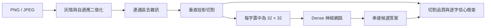

# Captcha OCR TFJS

[](https://github.com/root50643/captcha-ocr-tfjs/actions/workflows/ci.yml)

使用 TensorFlow.js 辨識固定五位數驗證碼，支援數字 **1–9**。包含已訓練模型、已確認資料、單張／批次推論、人工標註、訓練與回歸測試；安裝後可直接在本機執行。

| 原圖                                | 辨識結果 |
| ----------------------------------- | -------- |
|  | `14662`  |
|  | `99511`  |

## 快速開始

需要 **Node.js 22 以上**及 npm。套件版本由 `package-lock.json` 鎖定；CI 檢查 Node.js 22、24 與 Windows、Linux。

```bash
git clone https://github.com/root50643/captcha-ocr-tfjs.git
cd captcha-ocr-tfjs
npm ci
npm run solve -- data/raw/14662.png
npm test
```

批次報告使用 `npm run predict`，再以瀏覽器開啟本機的 `reports/raw-predictions/report.html`。推論使用隨附的 `model/`，不需先收集資料或重新訓練。

## 演算法

流程為「影像前處理 → 五個字元切割 → 單字分類 → 品質判定」。影像處理由共用的 [preprocess-core.js](src/preprocess-core.js) 實作，Node.js 與瀏覽器使用同一份程式。



### 1. 灰階與自適應二值化

先將透明像素合成到白底，再用 `gray = round(0.299R + 0.587G + 0.114B)` 轉為灰階。

每個像素以鄰近 **21 × 21** 區域的平均亮度建立局部閾值。若 `gray(x,y) < localMean(x,y) - 7`，就視為文字前景（1），其餘為背景（0）。邊緣視窗會裁到圖片範圍內。使用積分影像計算區域總和，每個像素的平均值查詢只需固定次數運算，整體時間與像素數成正比。

### 2. 去雜訊並保留斷開筆畫

以 **8 鄰接連通區**移除面積小於 3 像素的碎點，再取面積最大的至多五個區塊，以高度與面積中位數判斷相對小雜訊。只有「高度低於參考值 40%」且「面積低於參考值 30%」同時成立才視為小區塊，避免誤刪細長的 `1`。

小區塊若與附近主要字形有足夠水平重疊、面積與寬度，且垂直間距及合併後高度合理，就保留為斷開筆畫。例如被裁切的 `2` 底部短橫仍屬同一個字；程式保留像素，不補畫連接線。細節與回歸圖片見 [斷開筆畫修正紀錄](docs/history/detached-stroke-fix.md)。

### 3. 垂直投影與字元切割

將每欄的前景像素加總，得到垂直投影；連續有墨跡的欄形成候選區。兩區間若僅隔一個空白欄，會合併。

不足五區時，只有寬度明顯偏大、內部存在足夠深投影谷的區域才嘗試拆開。拆分要求寬度大於 `max(12, 1.6 × 中位寬度)`，並檢查谷附近三欄總和不超過峰值的 75%。不會對任意圖片強制等分五份。

每區上下邊界從整個字元欄的兩端搜尋，包含斷開的上蓋或底部筆畫，並保留 1 像素裁切邊界。字數不符、過小碎片或過寬字形會記錄為切割異常。

### 4. 正規化與 Dense 分類器

每字以最近鄰取樣等比例縮放，置中到 **32 × 32** 畫布；文字內容最多占 **24 × 24**，至少保留 4 像素邊距。模型輸入為黑字 1、背景 0；儲存的 PNG 則為黑字白底。

模型由 [train.js](scripts/train.js) 建立，為多層感知器（MLP），共 **140,041** 個可訓練參數：

| 層              | 輸出                | 用途                      |
| --------------- | ------------------- | ------------------------- |
| Input / Flatten | 32 × 32 × 1 → 1,024 | 展平正規化像素            |
| Dense + ReLU    | 128                 | 學習字形特徵              |
| Dropout         | 128，rate = 0.25    | 訓練時隨機丟棄部分活化值  |
| Dense + ReLU    | 64                  | 組合特徵                  |
| Dense + Softmax | 9                   | 輸出依序對應 `1–9` 的分數 |

推論以 `argmax` 選出每字最高分標籤，依左到右串接；Dropout 在推論時停用。切割字元組成 `[字數, 32, 32, 1]` tensor 一次批次推論，暫存 tensor 在使用後釋放。

### 5. 信心與拒絕條件

`confidence` 是各字最高分的平均值，`minConfidence` 是其中最低值。Node.js API 的 `needsReview` 在以下任一條件成立時為 `true`：

- 切割品質無效。
- 字數不是五個。
- 最低字元信心不是有限值，或低於 **0.99**。

Softmax 分數與 99% 接受門檻不是實測正確率保證。即使回傳候選 `text`，仍應先檢查 `needsReview`。空白圖、嚴重黏連、不同字型、非五位數、數字 `0` 及英文字母不在此模型的支援範圍。

## API

```js
const { solveCaptchaFile } = require("./src/ocr");

async function main() {
  const result = await solveCaptchaFile("data/raw/14662.png");
  console.log(result.text, result.minConfidence, result.needsReview);
}

main().catch(console.error);
```

可透過 `{ modelDir: "其他模型目錄" }` 指定模型。完整欄位與擴充套件整合見 [推論說明](docs/inference.md)。

## 專案結構

```text
src/                  OCR API、影像處理、資料規則、模型 I/O、共用設定
scripts/              日常 CLI：收集、標註、訓練、評估、推論
scripts/history/      特定日期實驗的報告產生器
test/                 核心回歸、資料流程、可選的擴充套件整合測試
data/raw/             已確認答案的原圖
data/segmented/1–9/   已接受的正規化單字圖片
data/review/          待確認圖片及永久人工確認紀錄
data/manifest.json    原圖來源、標籤、切割、指紋與固定資料分組
model/                目前部署模型（版本控制）
models/               固定 labeler-baseline 與候選模型（版本控制）
docs/                 使用與維護說明；history/ 保存歷次實驗
reports/              本機產生的 HTML、CSV、JSON 報告（Git 忽略）
backups/              本機資料與模型備份（Git 忽略）
vendor/               TensorFlow.js 備援檔
```

模型目錄的 `model.json`、權重 `.bin`、`labels.json`、`preprocessing.json` 須一起保存。`models/labeler-baseline/` 固定供資料分類與困難樣本篩選，請勿用每次訓練結果覆寫。

## 資料與訓練流程

1. 匯入或收集原圖，以 SHA-256 去重；人工目視確認答案後更新 `data/raw-labels.json`。
2. `npm run prepare-data` 使用固定 baseline 切割與分類：切割有效、答案相符且逐字信心 ≥ 99% 才自動接受，其餘進入人工確認。
3. 查看 `data/review/index.html`，將已確認 PNG 移至 `data/review/confirmed/1/` 至 `9/`，保留完整檔名，再執行 `npm run review:import`。人工確認綁定圖片指紋，切割改變後須重新確認。
4. `npm run train` 產生候選模型與訓練報告；`npm run evaluate` 比較固定 baseline 與候選。
5. 檢查比較結果後，執行 `npm run evaluate -- --promote`。只有通過既定回歸與保留測試門檻時才更新 `model/`，更新前備份舊模型。

資料依**原圖**固定分組，同圖五個數字不跨訓練／驗證／測試組。每批 100 張收集圖以種子 42 分成 60／20／20；新增批次不重新分配舊資料。使用者匯入圖放入訓練組。

預設從 baseline 微調：Adam、categorical cross-entropy、學習率 `0.0001`、batch size `32`、`20` epochs，保存驗證損失最低的 epoch；測試組不參與梯度更新或 epoch 選擇。標籤使用 one-hot encoding。

```bash
npm run train
npm run evaluate
# 通過比較門檻後更新部署模型：
npm run evaluate -- --promote
```

收集、標註圖表及匯入格式見 [資料格式](docs/data-format.md)；訓練參數與評估限制見 [訓練說明](docs/training.md)。

## 常用維護指令

| 指令                                  | 用途                                             |
| ------------------------------------- | ------------------------------------------------ |
| `npm run verify`                      | 格式、JavaScript 語法與核心測試；CI 使用同一指令 |
| `npm run format`                      | 統一程式及文件格式                               |
| `npm run solve -- data/raw/14662.png` | 單張推論                                         |
| `npm run predict`                     | 產生批次推論報告                                 |
| `npm run prepare-data`                | 整理原圖、切割與人工確認清單                     |
| `npm run review:import`               | 匯入已確認單字                                   |
| `npm run labeling:sheets -- 批次名稱` | 產生不顯示模型答案的標註圖表                     |
| `npm run labeling:apply -- 批次名稱`  | 匯入獨立判讀的 transcriptions.json               |
| `npm run test:extension`              | 在另有擴充套件專案時執行整合測試                 |
| `npm run sync:extension`              | 同步部署模型與共用前處理至擴充套件               |

擴充套件預設位於相鄰的 `admis-captcha-extension/`；其他位置可設定 `CAPTCHA_EXTENSION_DIR`。擴充套件是獨立專案，目前 1.2.2 在切割有效且為五字時填入候選：每字至少 95% 顯示綠色，低信心顯示黃色人工確認提示；此專案的資料與 Node.js API 審核門檻仍為 99%。

`npm run report:hard` 是 **2026-09-12 指定批次**的歷史工具，需先有對應訓練與比較報告，輸出在 `reports/hard-examples/`。模組責任與修改流程見 [維護說明](docs/maintenance.md)。

## 已保存的實驗結果

隨附 1.2.0 資料快照有 **333 張原圖、1,665 個已接受單字**。2026-09-12 微調的兩組保留測試各為 20/20；全資料為 332/333，但包含訓練資料，不能代表泛化能力。困難測試組經舊模型低信心篩選，亦不代表所有網站圖片的分布。

詳見 [低信心樣本補強紀錄](docs/history/hard-example-training.md) 與 [CHANGELOG](CHANGELOG.md)。這些是已保存實驗的結果；本次維護整理沒有重新訓練或改變部署模型。

## 授權

本專案採 [MIT License](LICENSE)。`vendor/tf.min.js` 為 TensorFlow.js 的第三方發行檔，保留原始授權標頭；一般安裝優先使用 npm 的 `@tensorflow/tfjs`。
