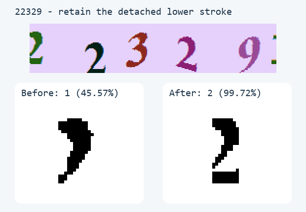

# 1.1.1：開頭數字 2 的斷開筆畫修正

`22329` 的首字底部仍存在於原圖，但因左側裁切使上下筆畫斷開，底部 82 個像素被相對尺寸去雜訊誤刪。原裁切高度因此僅 27 像素，模型讀成 `1`。

修正分為兩步：保留與可信主筆畫水平重疊、垂直接近且尺寸合理的小筆畫，再從上、下兩端找字元欄內第一個及最後一個前景像素。沒有連接或補畫筆畫。右側獨立雜訊缺少對齊的主筆畫，仍會被排除。

| 原圖  | 首字原信心       | 修正後首字信心   | 結果               |
| ----- | ---------------- | ---------------- | ------------------ |
| 22329 | 45.57%（預測 1） | 99.72%（預測 2） | 整張改為 22329     |
| 21629 | 53.06%           | 99.50%           | 保持正確，補回底部 |
| 21652 | 57.96%           | 99.57%           | 保持正確，補回底部 |
| 22873 | 57.08%           | 99.69%           | 保持正確，補回底部 |

以上百分比均為模型信心分數。22329 首字的框由 `(x=0,y=7,width=15,height=27)` 改為 `(x=0,y=7,width=15,height=35)`，包含完整可見底部。

## 驗證與交付

- 部署模型权重不變，共用前處理同步至擴充套件 1.1.1。
- 225 張逐一與修改前比對，只有上述四張的首字裁切發生改變，沒有新增錯誤。
- 全資料由 223/225 提升至 224/225；剩餘錯誤是 41437 首字 4 被模型辨成 1，仍留待人工確認。
- 每字均達 99% 的自動接受圖片由 201 張增至 204 張，接受但錯誤仍為 0 張；保留測試組維持 20/20。
- 數字分類由 1,100 個增至 1,104 個；待確認由 25 個降為 21 個。沒有將其他低信心項目一律當成已確認。
- 新增真实 22329 與另外三個裁切 2 的檢查，以及斷開頂部／底部、無關雜訊的測試；原 smoke tests 與 13 組回歸測試全部通過。
- 原 42385 右側雜訊案例仍辨識正確，Node.js 與瀏覽器的像素及模型推論一致。

原始資料、修改前程式、舊分類清單及 1.1.0 ZIP 已保留在 backups/detached-stroke-\*/；重切前數字圖片另由 prepare-data 保存。

data/review/index.html、批次推論與模型比較報告已更新。重新載入相鄰擴充套件資料夾，或解壓工作區根目錄的新版 admis-captcha-extension.zip 後再載入。

訓練候選模型仍保留上一輪權重，沒有因本次裁切修改而重新訓練；最新比較報告是用新前處理重新評估既有權重。全資料結果包含訓練資料，不能視為未來圖片正確率的保證。

> 歷史紀錄：此頁保留當時的資料與門檻。現行操作請看 [README](../../README.md)；reports/ 不隨 Git 發布，需在本機重新產生。
